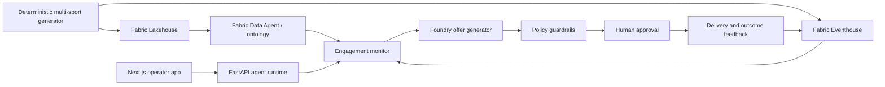

# Sports-IQ

Sports-IQ is a public, sport-neutral reference implementation for real-time fan
engagement with Microsoft Fabric, Microsoft Foundry, Azure Container Apps, and
the Microsoft Agent Framework. It combines live engagement signals, historical
fan context, policy guardrails, human approval, delivery orchestration, and a
closed-loop outcome signal.

All included demo data is deterministic and explicitly fictional. No generated
CSV, JSONL, or Parquet datasets are committed.

## Architecture



The Azure deployment creates a private agent-runtime Container App, a public
Next.js Container App that proxies API traffic, Azure Container Registry,
Key Vault, Storage, Log Analytics, and Application Insights. Fabric workspace
items are created or discovered through the Fabric REST API before Azure
provisioning. Workload access uses managed identity.

## One-click deployment with `azd up`

### Prerequisites

- An Azure subscription where you can create resource groups, role assignments,
  Container Apps, Container Registry, Key Vault, Storage, and monitoring
  resources.
- [Azure CLI](https://learn.microsoft.com/cli/azure/install-azure-cli) and
  [Azure Developer CLI](https://learn.microsoft.com/azure/developer/azure-developer-cli/install-azd).
- Python 3.12+, PowerShell 7+, Docker, and Git.
- A Microsoft Fabric capacity plus permission to create/manage workspaces and
  items, or an existing Fabric workspace where you are an administrator.
- A Microsoft Foundry project with a deployed chat model.

### AI-assisted recreation

This repository is designed to be recreated by a coding agent as well as by a
human operator. Open the cloned repository with your coding agent and provide
this prompt:

> Read `AGENTS.md`, `.github/copilot-instructions.md`, `README.md`, and
> `azure.yaml`.
>
> Recreate and validate Sports-IQ on my machine. Begin with a non-destructive
> preflight: verify required tools, Docker engine status, Azure authentication,
> Fabric access, and the current azd environment. Do not create or modify cloud
> resources during preflight.
>
> Report only the required configuration values that are missing. After I
> provide them, run the documented `azd up` lifecycle. Do not bypass Fabric or
> Foundry failures, introduce fallback credentials, or report success unless
> post-deployment validation passes.
>
> At completion, report the web URL, commands for retrieving demo credentials,
> Fabric items created or reused, validation results, and any administrator
> actions still required. Never print secret values.

The agent should treat `AGENTS.md` as the operational contract and
`.github/copilot-instructions.md` as the repository implementation contract.

### Recreate the solution

```powershell
git clone https://github.com/<owner>/<repository>.git
Set-Location <repository>

az login
azd auth login
azd env new

azd env set FOUNDRY_PROJECT_ENDPOINT "https://<account>.services.ai.azure.com/api/projects/<project>"
azd env set FOUNDRY_PROJECT_RESOURCE_ID "/subscriptions/<subscription>/resourceGroups/<group>/providers/Microsoft.CognitiveServices/accounts/<account>/projects/<project>"
azd env set FOUNDRY_MODEL "gpt-4.1"

# Choose one Fabric path:
azd env set FABRIC_CAPACITY_ID "<capacity-guid>"
# or:
azd env set FABRIC_WORKSPACE_ID "<existing-workspace-guid>"
```

### Preflight

Docker must be installed and its engine must be running. Perform this
non-destructive check before provisioning:

```powershell
docker version
az version
azd version
python --version
pwsh --version
az account show
azd env get-values
```

Each command must succeed. `docker version` must display both client and server
information. Confirm the required Foundry values and one Fabric option are
present, then deploy:

```powershell
azd up
```

`azd up` performs these steps:

1. Checks CLI authentication and required configuration.
2. Generates strong web authentication secrets into the azd environment.
3. Generates deterministic fictional data for basketball, football, soccer,
   and hockey.
4. Creates or discovers the Fabric workspace, Lakehouse, Eventhouse/KQL
   database, and bootstrap notebook.
5. Uploads seed files to OneLake, loads Lakehouse tables, creates KQL tables,
   and ingests live-event fixtures.
6. Provisions Azure resources and deploys both containers.
7. Grants the backend managed identity Fabric workspace and Foundry project
   access.
8. Fails explicitly if a tenant blocks an API or role assignment; it does not
   report a partial deployment as successful.

Generated credentials can be retrieved when needed with:

```powershell
azd env get-value ADMIN_USERNAME
azd env get-value ADMIN_PASSWORD
azd env get-value WEB_URL
```

Treat the password output as a secret and do not paste it into issue reports or
shell scripts.

## Run the demo

Retrieve the deployed URL and operator credentials:

```powershell
$webUrl = azd env get-value WEB_URL
azd env get-value ADMIN_USERNAME
azd env get-value ADMIN_PASSWORD
Start-Process $webUrl
```

1. Sign in with the generated operator credentials.
2. Select a fictional fan by loyalty tier or venue section.
3. Start the engagement workflow.
4. Observe the Engagement Monitor evaluate engagement and offer fatigue.
5. Review the offer generated with Fabric and Foundry context.
6. Approve or reject the offer in the human-approval card.
7. For an approved offer, use the redemption panel to simulate a fictional POS
   redemption.
8. Confirm that the workflow reaches its terminal state and the outcome is
   reflected in the application.

For the presentation narrative, see `docs/Clickthrough-Demo-Guide.md` and
`demo/SportsIQ-AI-Voiceover-Demo-Sequence.md`.

### Successful deployment criteria

Deployment is complete only when:

- The web application and backend health checks pass.
- The web application reaches the private backend through `/api/agents/*`.
- Required Lakehouse and Eventhouse tables exist with deterministic fictional
  seed records.
- The backend managed identity can access Fabric and Foundry.
- A workflow reaches human approval and a terminal outcome.
- `scripts/azd/validate_deployment.ps1` exits successfully.

A partially provisioned Fabric or Foundry environment is not a successful
deployment.

## Local development

### Backend

```powershell
python -m venv .venv
.\.venv\Scripts\Activate.ps1
pip install -r agents\requirements.txt
Copy-Item agents\.env.example agents\.env
# Populate required Foundry and Fabric endpoints in agents\.env.
uvicorn agents.server:app --reload --port 8000
```

### Frontend

```powershell
Set-Location webapp
npm ci
Copy-Item .env.local.example .env.local
# Set AUTH_SECRET and ADMIN_PASSWORD.
npm run dev
```

The browser calls same-origin `/api/agents/*`; the Next.js server proxies those
requests to `AGENTS_API_URL`.

## Tests and validation

```powershell
# Python suite
python -m pytest tests

# One pytest
python -m pytest tests\test_policy_guardrail.py::test_all_pass

# Frontend
Set-Location webapp
npm run lint
npm run build

# Infrastructure, when installed
az bicep build --file ..\infra\main.bicep
azd config show
```

## Configuration contract

| Setting | Source | Required | Purpose |
|---|---|---:|---|
| `FOUNDRY_PROJECT_ENDPOINT` | user | yes | Foundry project endpoint |
| `FOUNDRY_PROJECT_RESOURCE_ID` | user | yes for deployment | Managed identity RBAC scope |
| `FOUNDRY_MODEL` | user/default | yes | Deployed model name |
| `FABRIC_CAPACITY_ID` | user | when creating workspace | Fabric capacity |
| `FABRIC_WORKSPACE_ID` | user/discovered | optional | Existing workspace |
| `EVENTHOUSE_URI` | discovered | yes at runtime | KQL query endpoint |
| `LAKEHOUSE_SQL_ENDPOINT` | discovered | yes at runtime | Lakehouse SQL endpoint |
| `AUTH_SECRET` | generated secret | yes | Session signing |
| `ADMIN_PASSWORD` | generated secret | yes | Demo operator login |
| `SPORTS_IQ_SPORT` | user/default | yes | Active guardrail/UI variant |

See `.env.example`, `agents/.env.example`, and
`webapp/.env.local.example` for local-only configuration.

## Fabric provisioning order

1. Authenticate to Azure CLI with a user authorized for Fabric.
2. Resolve or create the workspace.
3. Resolve or create the Lakehouse, Eventhouse/KQL database, and notebook.
4. Upload `data/generated` to `Files/synthetic`.
5. Load the static CSV files into Delta tables.
6. Create KQL tables and ingest JSONL events.
7. Record SQL and KQL endpoints in the azd environment.
8. After Azure provisioning, grant the backend managed identity workspace
   membership.

The operational ontology is in `fabric/ontology/sports_iq_ontology.yaml`, Data
Agent instructions are under `fabric/data_agent/`, and bootstrap code is in
`scripts/fabric_bootstrap.py`.

## Documentation and GTM assets

- High-level and technical architecture: `docs/High-Level-Design.md` and
  `docs/Technical-Architecture.md`
- Outcome-led GTM narrative: `docs/SportsIQ-Outcome-Led-GTM.md` and `.html`
- Presentation/design assets: `docs/SportsIQ-Fan Engagement.pptx` and
  `Sports-IQ-Design.png`
- Clickthrough and voiceover: `docs/Clickthrough-Demo-Guide.md` and
  `demo/SportsIQ-AI-Voiceover-Demo-Sequence.md`
- Governance: `docs/Guardrail-Inventory.md` and
  `docs/plans/customer-skill-governance/`

## Troubleshooting

- **Workspace creation fails:** verify `FABRIC_CAPACITY_ID`, capacity state, and
  that the signed-in user can create workspaces.
- **Fabric API returns 403:** tenant settings may block service principal or
  item APIs. The hook stops and prints the exact manual membership action.
- **Foundry role assignment fails:** confirm the full project resource ID and
  that you can create role assignments at that scope.
- **Backend will not start:** check the three required runtime endpoints with
  `azd env get-values`, then inspect Container App logs.
- **ODBC connection fails locally:** install Microsoft ODBC Driver 18 for SQL
  Server and authenticate with `az login`.
- **Web build reports missing environment:** production API routing is
  server-side; set `AGENTS_API_URL`, `AUTH_SECRET`, and admin credentials.

## Public contribution boundaries

Do not contribute tenant IDs, subscription IDs, workspace/item IDs, credentials,
webhook URLs, real deployment URLs, personal contact data, customer names, or
generated datasets. Use fictional organizations and regenerate demo data from
code. Sport-specific additions must be independently licensed, optional, and
must not make the baseline depend on a league, team, or proprietary dataset.

## License

See [LICENSE](LICENSE).
