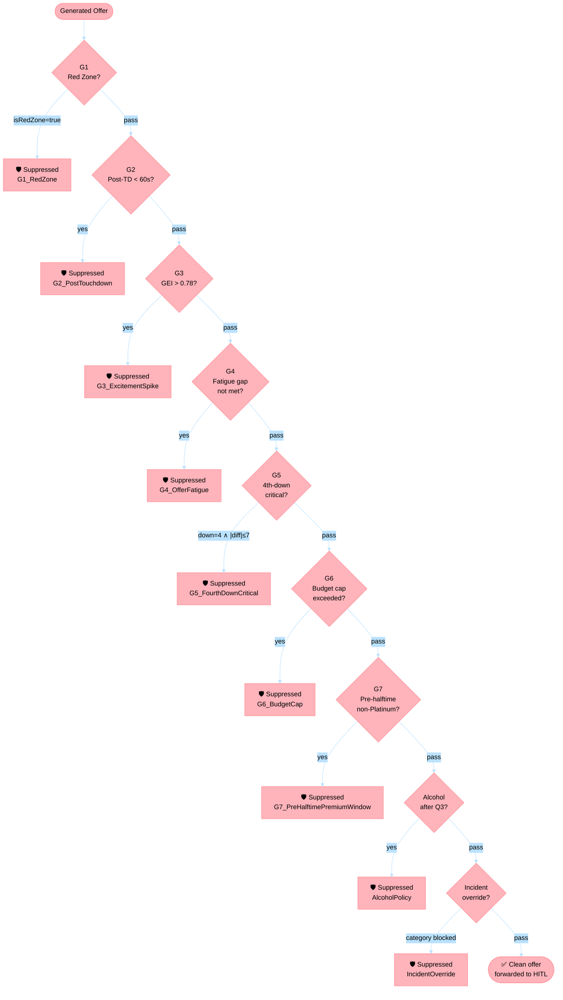
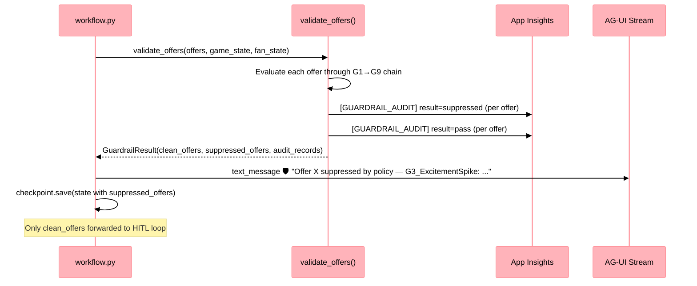

# Sports-IQ Guardrail Inventory

**Platform:** Sports-IQ professional football Fan Engagement — Harbor Center  
**Policy Source:** `fabric/data_agent/Sports-IQ-Offer-Policy.md` v2.3  
**Enforcement Layer:** `agents/middleware/policy_guardrail.py` (MAF `FunctionMiddleware`)  
**Last Updated:** 2026-06-11

---

## Overview

The guardrail system provides **deterministic, pre-HITL enforcement** of the Sports-IQ Offer Policy.
No offer that violates a guardrail ever reaches the human reviewer.

### Two-layer design

| Layer | Mechanism | Role |
|-------|-----------|------|
| **Knowledge** | Foundry IQ (Phase 2) | LLM *understands* policy — improves offer quality and category selection |
| **Governance** | `PolicyGuardrailMiddleware` (Phase 1 ✅) | System *enforces* hard rules — deterministic, auditable, non-negotiable |

### Evaluation order

Guardrails are evaluated **strictly in this order** per §3 of the policy. The first one that fires
suppresses the offer; subsequent checks are skipped.



---

## Guardrail Reference

### G1 — Red Zone Suppression

| Field | Value |
|-------|-------|
| **Guardrail ID** | `G1_RedZone` |
| **Policy ref** | §3 Guardrail 1 |
| **Condition** | `isRedZone == true` |
| **Scope** | All offers, all fans |
| **Override** | **None — absolute** |
| **game_state key** | `isRedZone` (bool) |
| **Missing data** | Fail-open (warning logged) |

The team is in the red zone. Fan attention is at maximum. No offer may interrupt this moment
regardless of loyalty tier, offer value, or any other condition.

---

### G2 — Post-Touchdown Celebration Window

| Field | Value |
|-------|-------|
| **Guardrail ID** | `G2_PostTouchdown` |
| **Policy ref** | §3 Guardrail 2 |
| **Condition** | `lastPlayType == "touchdown" AND timeSinceTD < 60 seconds` |
| **Scope** | All offers, all fans, both teams' touchdowns |
| **Override** | None |
| **game_state keys** | `lastPlayType` (str), `timeSinceTD` (int, seconds) |
| **Missing data** | Fail-open (warning logged) |

Fans celebrate or process every touchdown for approximately 60 seconds. Neither state is
receptive to commercial offers. The block applies regardless of which team scored.

---

### G3 — Game Excitement Suppression

| Field | Value |
|-------|-------|
| **Guardrail ID** | `G3_ExcitementSpike` |
| **Policy ref** | §3 Guardrail 3 |
| **Condition** | `gameExcitementIndex > 0.78` |
| **Scope** | All non-emergency offers |
| **Override** | None |
| **game_state key** | `gameExcitementIndex` (float); also mapped from `engagement_score` in monitor output |
| **Missing data** | Fail-open (warning logged) |

A close, dramatic game demands undivided attention. Interrupting a fan during a high-excitement
moment damages brand perception more than the offer is worth.

---

### G4 — Offer Fatigue

| Field | Value |
|-------|-------|
| **Guardrail ID** | `G4_OfferFatigue` |
| **Policy ref** | §3 Guardrail 4 |
| **Condition** | `minutesSinceLastOffer < tierMinimumGap` |
| **Override** | None |
| **fan_state keys** | `loyaltyTier` (str), `minutesSinceLastOffer` (int) |
| **Missing data** | Fail-open (debug logged) |
| **Source** | `OfferFeedbackEvent` (current game) → `promotion_history` (cross-game fallback) |

**Tier-specific minimum gaps:**

| Loyalty Tier | Minimum Gap | Rationale |
|-------------|-------------|-----------|
| Bronze | 60 minutes | Infrequent, high-relevance only |
| Silver | 45 minutes | Balanced cadence |
| Gold | 30 minutes | More frequent, personalised |
| Platinum | 20 minutes | Highest-value, responsive fans |

> **Note:** G4 is also enforced upstream by `EngagementMonitorAgent` (which returns
> `should_generate_offers: false` when fatigue is active). The middleware re-checks
> as **defense-in-depth** and for independent audit trail.

---

### G5 — 4th-Down Critical Play

| Field | Value |
|-------|-------|
| **Guardrail ID** | `G5_FourthDownCritical` |
| **Policy ref** | §3 Guardrail 5 |
| **Condition** | `down == 4 AND abs(scoreDifferential) <= 7` |
| **Scope** | All offers |
| **Override** | None |
| **game_state keys** | `down` (int), `scoreDifferential` (int) |
| **Missing data** | Fail-open (warning logged) |

4th-down decisions in close games are the most dramatic moments in football. The absolute
focus of every fan in the stadium must not be fractured by a commercial notification.

---

### G6 — Per-Fan Budget Cap

| Field | Value |
|-------|-------|
| **Guardrail ID** | `G6_BudgetCap` |
| **Policy ref** | §3 Guardrail 6 |
| **Condition** | `totalOffersThisGame > maxOffers` OR `totalOfferValueThisGame > maxValue` |
| **Override** | None |
| **fan_state keys** | `loyaltyTier`, `totalOffersThisGame` (int), `totalOfferValueThisGame` (float) |

**Tier-specific budget caps:**

| Loyalty Tier | Max Offer Value / Game | Max Offers / Game |
|-------------|------------------------|-------------------|
| Bronze | $25 total discount value | 3 offers |
| Silver | $40 total discount value | 4 offers |
| Gold | $75 total discount value | 6 offers |
| Platinum | $150 total discount value | 8 offers |

Once a fan hits either cap, no further offers are sent for the remainder of the game.

---

### G7 — Pre-Halftime Premium Window

| Field | Value |
|-------|-------|
| **Guardrail ID** | `G7_PreHalftimePremiumWindow` |
| **Policy ref** | §3 Guardrail 7 |
| **Condition** | `gameClockQ2 < 2:30 AND loyaltyTier != "Platinum"` |
| **Effect** | Only Platinum-tier fans receive offers in this window |
| **game_state key** | `gameClockQ2LessThan2m30s` (bool) |
| **fan_state key** | `loyaltyTier` |
| **Missing data** | Fail-open (debug logged) |

The Q2 2-minute warning is a high-conversion but high-attention window. Reserve it for the
fans most statistically likely to convert — Platinum tier only.

---

### Alcohol Policy

| Field | Value |
|-------|-------|
| **Guardrail ID** | `AlcoholPolicy` |
| **Policy ref** | §4.1 Food & Beverage |
| **Condition** | Offer title/description contains alcohol keywords AND `quarter >= 4` |
| **Scope** | Offers containing: `alcohol`, `beer`, `wine`, `spirits`, `cocktail`, `draft pint`, `brew` |
| **Override** | None — professional football stadium regulation |
| **game_state key** | `quarter` (int) |
| **Missing data** | Fail-open (debug logged) |

professional football stadium policy prohibits alcohol sales after Q3 kickoff. Alcohol-related offers
are blocked in Q4 and overtime. Additionally, no alcohol offers may target fans flagged
in the venue's responsible service system (§8 Compliance — enforced at fan profile level).

---

### Stadium Incident Override

| Field | Value |
|-------|-------|
| **Guardrail ID** | `IncidentOverride` |
| **Policy ref** | §6 Stadium Incident Override |
| **Condition** | `activeIncident.status == "active"` AND `offer.category in restrictedOfferCategories` |
| **Scope** | Offers in the incident's restricted category for fans in affected sections |
| **Override** | **None — absolute block** |
| **game_state key** | `activeIncident` (dict with `restrictedOfferCategories` list) |

When a stadium incident is active (e.g., a concession zone alarm), all offers in the
restricted categories for affected sections are suppressed. This is distinct from the
existing `incident_alert` flag (which surfaces to HITL for human judgment on ambiguous
cases) — the guardrail fires only when the offer category is **explicitly** in the
incident's `restrictedOfferCategories` list.

---

## Audit Trail

Every guardrail evaluation — pass **or** fail — writes a `GuardrailAuditRecord`:

```json
{
  "offer_id": "offer_abc123",
  "guardrail": "G3_ExcitementSpike",
  "result": "suppressed",
  "reason": "gameExcitementIndex=0.831 > 0.78",
  "policy_ref": "§3 Guardrail 3",
  "evaluated_at": "2025-11-02T20:14:33.812Z",
  "context_snapshot": {
    "game_state": { "gameExcitementIndex": 0.831, "quarter": 4, "isRedZone": false },
    "fan_state": { "loyaltyTier": "Gold", "minutesSinceLastOffer": 35 }
  }
}
```

Records are emitted via `log.info("[GUARDRAIL_AUDIT] ...")` and land in **Application Insights**.

**KQL query — suppressed offers by guardrail:**

```kql
traces
| where message startswith "[GUARDRAIL_AUDIT]"
| extend record = parse_json(substring(message, 17))
| where record.result == "suppressed"
| summarize count() by tostring(record.guardrail)
| order by count_ desc
```

**KQL query — suppression rate by loyalty tier:**

```kql
traces
| where message startswith "[GUARDRAIL_AUDIT]"
| extend record = parse_json(substring(message, 17))
| extend tier = tostring(record.context_snapshot.fan_state.loyaltyTier)
| summarize
    total = count(),
    suppressed = countif(record.result == "suppressed")
  by tier
| extend suppression_rate = round(100.0 * suppressed / total, 1)
```

---

## Suppressed Offer Lifecycle



---

## Game-State Field Coverage

Fields required by the guardrails, and their current availability from the engagement monitor:

| Guardrail | Required Field | Source Today | Status |
|-----------|---------------|--------------|--------|
| G1 | `isRedZone` | Monitor JSON output | ⚠️ Fail-open until Eventhouse extended |
| G2 | `lastPlayType`, `timeSinceTD` | Monitor JSON output | ⚠️ Fail-open until Eventhouse extended |
| G3 | `gameExcitementIndex` | `engagement_score` from monitor | ✅ Available |
| G4 | `minutesSinceLastOffer` | `check_offer_fatigue_guard` tool → monitor JSON | ✅ Available |
| G5 | `down`, `scoreDifferential` | Monitor JSON output | ⚠️ Fail-open until Eventhouse extended |
| G6 | `totalOffersThisGame`, `totalOfferValueThisGame` | `check_offer_fatigue_guard` tool → monitor JSON | ✅ Available |
| G7 | `gameClockQ2LessThan2m30s` | Monitor JSON output | ⚠️ Fail-open until Eventhouse extended |
| Alcohol | `quarter` | `query_current_engagement` tool → monitor JSON | ✅ Available |
| Incident | `activeIncident` | Monitor JSON output | ⚠️ Fail-open (null by default) |

> **Fail-open** means: when the required field is absent, the guardrail passes (offer is not
> suppressed) and a `WARNING` is logged. This prevents false suppression due to missing data
> while maintaining a clear paper trail. Once the engagement monitor surfaces the missing fields
> from Eventhouse `GameContext` / `GameExcitementIndex` tables, those guardrails will become
> fully active.

---

## Implementation Reference

| Component | File |
|-----------|------|
| Policy source | `fabric/data_agent/Sports-IQ-Offer-Policy.md` |
| Guardrail implementation | `agents/middleware/policy_guardrail.py` |
| Middleware export | `agents/middleware/__init__.py` |
| Agent registration | `agents/offer_generator/agent_def.py` |
| Workflow integration | `agents/workflow.py` (after offer parsing, before HITL) |
| Monitor JSON schema | `agents/engagement_monitor/agent_def.py` (SYSTEM_PROMPT) |
| Sport-variant config | `agents/middleware/sport_variants.py` |
| Phase 2 (deferred) | `agents/shared/policy_agent.py` (Foundry IQ knowledge source) |

---

## Sport-Variant Guardrail Support

The guardrail system supports **four sports**, selectable via the `SPORTS_IQ_SPORT` environment variable.
Each sport defines its own thresholds and game-state field names while sharing the same G1–G7 evaluation pipeline.

### Activation

```bash
# In agents/.env
SPORTS_IQ_SPORT=football   # football | basketball | soccer | hockey
```

### Variant Comparison

| Guardrail | Football (professional football) | Basketball (professional basketball) | Soccer (professional soccer) | Hockey (professional hockey) |
|-----------|---------------|-----------------|-------------|-------------|
| **G1 — Scoring Zone** | `isRedZone` | `isFastBreak` | `isInPenaltyBox` | `isPowerPlay` |
| **G2 — Post-Score Window** | 60s (touchdown) | 15s (basket) | 90s (goal) | 45s (goal) |
| **G3 — Excitement Threshold** | GEI > 0.78 | GEI > 0.82 | GEI > 0.80 | GEI > 0.80 |
| **G4 — Fatigue (Bronze/Platinum)** | 60/20 min | 30/10 min | 45/12 min | 40/12 min |
| **G5 — Critical Play** | 4th down, &#124;diff&#124; ≤ 7 | Shot clock ≤ 5s, &#124;diff&#124; ≤ 5 | Penalty kick, &#124;diff&#124; ≤ 2 | Empty net, &#124;diff&#124; ≤ 2 |
| **G6 — Budget Cap (Plat)** | $150 / 8 offers | $120 / 14 offers | $100 / 10 offers | $120 / 12 offers |
| **G7 — Premium Window** | Q2 < 2:30 | Q4 < 2:00 | Stoppage time | P3 < 2:00 |
| **Alcohol Cutoff** | Q4+ | Q4+ | H2+ | P3+ |
| **Extra Suppressions** | — | Free throw | VAR review, injury stoppage | Penalty shot |

### Configuration Module

Sport configs are defined as frozen dataclasses in `agents/middleware/sport_variants.py`.
The active config is resolved once at module load time from `SPORTS_IQ_SPORT` and used by
all guardrail functions in `policy_guardrail.py`.
