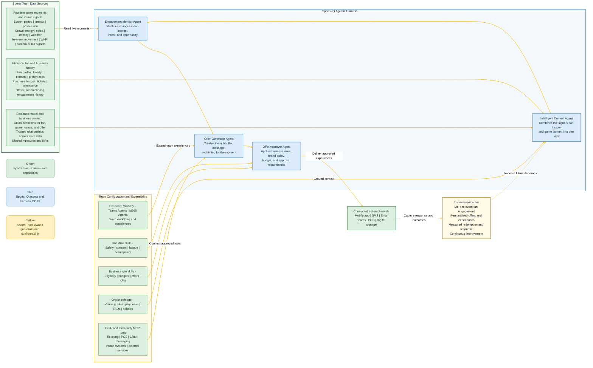

# Sports-IQ Architecture
### A simple view of the sports data, AI agents, and business actions that work together

Sports-IQ helps sports organizations turn live fan signals into timely, relevant engagement. The team brings the data and connects the channels; the Sports-IQ harness provides the intelligence, decisioning, and orchestration.

---

## How It Works

**Color key:** Green = sports team inputs and channels | Blue = Sports-IQ agents and orchestration | Yellow = business outcomes and learning

---

## Responsibility Matrix

| Area | Sports team brings and connects | Sports-IQ harness provides | Result for the business |
|---|---|---|---|
| **Fan identity and profile** | Fan ID, loyalty tier, consent, preferences, and relevant history | Creates a usable fan context across systems | More relevant experiences for each fan |
| **Attendance and ticketing** | Ticket purchase, entry, seat or section, membership, and suite information | Connects the fan to the current game and location | Better timing and audience selection |
| **Purchases and commerce** | POS transactions, product catalog, concession locations, and redemption data | Finds opportunities and measures response | Increased conversion and revenue insight |
| **Digital engagement** | App events, web activity, message responses, and channel preferences | Detects changes in interest and intent | Timely engagement without guesswork |
| **Game and venue context** | Score, period, timeout, game state, crowd, and venue signals | Understands the moment before recommending action | Offers that fit what is happening now |
| **Unstructured knowledge** | Venue guides, playbooks, policies, documents, FAQs, and other approved content | Grounds context and recommendations in team knowledge | More useful, explainable decisions |
| **Skills and governance** | Configurable skills, prompts, policies, approvals, budgets, and Copilot workflows | Connects team configuration directly to the agentic harness | Governed intelligence that reflects team priorities |
| **MCP tools and services** | First- and third-party tools for ticketing, POS, CRM, messaging, venue systems, and external services | Connects tools to the right agent and action | More automation across the existing ecosystem |
| **Offers and business rules** | Offer catalog, budgets, eligibility, brand policy, and approval contacts | Generates, checks, and routes recommendations | Controlled personalization at scale |
| **Delivery channels** | Access to mobile app, messaging, POS, Teams, or signage endpoints | Orchestrates approved actions through the right channel | A connected fan engagement workflow |
| **Feedback and measurement** | Redemption, dismissal, opt-out, revenue, and campaign outcomes | Feeds results back into future recommendations | A measurable, continuously improving program |

---

## The Agent Team at a Glance

| Agent or tool | Plain-language responsibility |
|---|---|
| **Intelligent Context Agent** | Brings the relevant fan, game, and business information together from realtime, historical and semantic sources. |
| **Engagement Monitor Agent** | Watches for meaningful changes in fan interest or behavior. |
| **Offer Generator Agent** | Recommends what to say, what to offer, and when to act. |
| **Offer Approver Agent** | Ensures every action follows business, brand, budget, and approval rules. |
| **Connected action channels** | Deliver the approved experience and return the response. |

---

## What a Sports Team Needs to Bring

Start with the data and channels that are available today. A useful first connection typically includes:

- A way to identify a fan or audience, with the required consent and privacy controls
- Current game, attendance, ticketing, or venue context
- Purchase or redemption history, if offers or commerce are in scope
- At least one engagement signal, such as app activity, messaging response, or attendance behavior
- An offer catalog and the business rules that govern eligibility, budget, brand, and approval
- One delivery channel and a way to capture the outcome

The harness can expand as more sources become available. The core pattern remains simple: **connect the signal, understand the moment, make a governed decision, act, and learn from the response.**

---

