# Customer Skill Governance Implementation Plan

## Summary

Sports-IQ will allow each customer to influence agent behavior through versioned Markdown skill files while preserving deterministic platform authority. Customer skills define desired business outcomes, priorities, terminology, examples, bounded preferences, and approved knowledge references. They do not grant tools, expand data access, weaken consent or safety rules, approve their own actions, or directly execute side effects.

The governing principle is **influence versus authority**:

- Customer Markdown has strong influence over reasoning and candidate generation.
- Authoritative data determines what is true about the fan, game, inventory, consent, and venue.
- Deterministic platform code decides whether a candidate action is permitted.
- Human approval remains mandatory where the policy or tenant risk profile requires it.
- Idempotent workers, rather than an LLM, perform irreversible side effects.

This plan builds on the current offer workflow in [workflow_nodes_edges.py](../../../agents/workflow_nodes_edges.py), deterministic rules in [policy_guardrail.py](../../../agents/middleware/policy_guardrail.py), the offer generator in [agent_def.py](../../../agents/offer_generator/agent_def.py), and the production gaps documented in [SportsIQ-Outcome-Implementation-Gap-Analysis.md](../../SportsIQ-Outcome-Implementation-Gap-Analysis.md).

## Why This Design

Markdown is appropriate for living **procedural memory** because it is readable by business users, reviewable, diffable, versionable, and expressive enough to capture customer intent. It should materially affect runtime behavior. The unsafe step would be treating natural-language instructions as authorization or as authoritative operational data.

Sports-IQ therefore uses two separate precedence models:

### Authority Precedence

1. Tenant identity, permissions, consent, and tool capability boundaries.
2. Deterministic platform policy and safety rules.
3. Customer-authored skill instructions and bounded preferences.
4. Platform model defaults.

### Truth Precedence

1. Authoritative, current, tenant-scoped operational data.
2. Provenance-bearing organizational knowledge.
3. Customer procedural guidance in the active skill release.
4. Model inference.

This distinction prevents a Markdown statement such as “inventory is available” from overriding a live inventory service, while still allowing “prefer experiential rewards over discounts” to shape candidate selection.

For bounded customer preferences, the effective value is constrained by platform policy:

$$
\text{effective value} = \min(\text{customer preference},\ \text{platform maximum})
$$

For lower bounds, the platform applies the corresponding maximum:

$$
\text{effective minimum} = \max(\text{customer preference},\ \text{platform minimum})
$$

## Target Decision Flow

```mermaid
%%{init: {'theme':'base', 'themeVariables': {
  'primaryColor':'#FFB3BA',
  'primaryTextColor':'#000',
  'primaryBorderColor':'#FF8B94',
  'lineColor':'#BAE1FF',
  'secondaryColor':'#BAE1FF',
  'tertiaryColor':'#FFFFFF'
}}}%%
flowchart LR
    A[Authenticated tenant administrator] --> B[Draft Markdown skill]
    B --> C[Parse and validate]
    C --> D[Offline and adversarial evaluation]
    D --> E[Immutable skill release]
    E --> F[Compile bounded instruction block]
    G[Authoritative fan and game context] --> H[Offer generator]
    F --> H
    H --> I[Typed candidate action]
    I --> J[Deterministic policy decision]
    G --> J
    J -->|Allowed| K[HITL when required]
    J -->|Denied or indeterminate| L[Suppress and audit]
    K --> M[Idempotent action worker]
    M --> N[Receipt and feedback event]
    N --> O[Evaluation and memory proposal]
    O --> B
```



## Scope

### In Scope

- A customer skill package centered on `SKILL.md` with typed YAML frontmatter.
- Tenant-scoped loading, validation, compilation, versioning, and release manifests.
- Injection of the active skill into offer generation without changing tool grants.
- Typed candidate offers and deterministic, fail-closed policy decisions.
- Offline, adversarial, workflow, shadow, canary, and continuous evaluations.
- Administrative APIs and a later UI for draft, compare, evaluate, promote, roll back, and revoke.
- Procedural-memory promotion based on evidence and explicit review.
- Auditability from skill release through policy decision, approval, delivery, and outcome.

### Out of Scope for the First Increment

- Letting customers upload executable Python or arbitrary tools.
- Autonomous promotion of learned behavior directly into production.
- Replacing authoritative Eventhouse, Lakehouse, consent, inventory, or identity data with Markdown.
- Removing HITL from high-risk actions.
- Solving durable orchestration only by splitting the current agents into more Container Apps.

## Requirements

| ID | Requirement |
| --- | --- |
| REQ-001 | A tenant administrator can author a Markdown skill that materially influences offer objectives, priorities, terminology, examples, and bounded preferences. |
| REQ-002 | Deterministic platform policy always supersedes customer instructions and model output. |
| REQ-003 | Missing, stale, malformed, or contradictory mandatory policy context produces a denied or indeterminate decision, never an implicit pass. |
| REQ-004 | Agent output is parsed into a strict typed candidate-action contract before policy evaluation. |
| REQ-005 | Every runtime decision references an immutable skill release manifest containing tenant, content digest, compiler, policy, model, tool-contract, and evaluation versions. |
| REQ-006 | A skill follows draft, schema-valid, evaluated, shadow, tenant-canary, active, retired, and revoked lifecycle states with explicit promotion gates. |
| REQ-007 | Tenant identity comes from authenticated claims and scopes all skill, data, cache, evaluation, trace, and execution access. |
| REQ-008 | Skills cannot grant tools, credentials, data scope, consent bypasses, evaluator exemptions, or direct side-effect authority. |
| REQ-009 | Each run records skill influence, retrieved evidence, candidate action, policy result, approval, execution receipt, and business outcome under one correlation contract. |
| REQ-010 | Organizational learning proposes evidence-linked procedural-memory changes; humans and evaluation gates approve promotion. |
| REQ-011 | Operators can immediately pause, roll back, retire, or revoke a skill release without redeploying the application. |
| REQ-012 | Approval and side-effect execution are durable, replay-safe, and idempotent before autonomous production use. |
| REQ-013 | Tenant administrators can safely draft, validate, compare, evaluate, and promote skills through governed APIs and an accessible UI. |
| REQ-014 | Skill resolution and policy enforcement preserve the possession-level latency target through caching, time budgets, freshness limits, and stale-action cancellation. |

## Customer Skill Contract

The Markdown body carries natural-language procedural guidance. YAML frontmatter carries only fields that the runtime must validate deterministically. Unknown fields are rejected to prevent accidental shadow configuration.

```markdown
---
schemaVersion: 1
skillId: premium-retention
version: 4
objective: increase_retention
priority: high
parameters:
  preferredOfferTypes:
    - seat_upgrade
    - loyalty_points
  maximumDiscountPercent: 15
  targetSegments:
    - high_value_at_risk
knowledgeReferences:
  - venue/premium-experiences
---

Prioritize recognition and experiential rewards over discounts.

Do not interrupt fans during high-excitement possessions.

For premium members, prefer seat upgrades when inventory is available.
```

The compiler converts this package into a delimited instruction block. It does not concatenate unchecked Markdown directly into the system prompt. The compiled result includes the tenant and release identifiers, normalized bounded parameters, approved knowledge references, and the customer guidance labeled as untrusted procedural input.

## Technical Context

### Existing Components to Reuse

| Concern | Existing anchor | Planned use |
| --- | --- | --- |
| Offer reasoning | [agents/offer_generator/agent_def.py](../../../agents/offer_generator/agent_def.py) | Accept a compiled skill instruction block and continue using a fixed platform system prompt and fixed tools. |
| Workflow integration | [agents/workflow_nodes_edges.py](../../../agents/workflow_nodes_edges.py) | Resolve the active release, pass it to generation, validate typed candidates, and persist decision metadata. |
| Hard policy | [agents/middleware/policy_guardrail.py](../../../agents/middleware/policy_guardrail.py) | Return allowed, denied, or indeterminate decisions with policy version and required-context failures. |
| Guardrail tests | [tests/test_policy_guardrail.py](../../../tests/test_policy_guardrail.py) | Replace fail-open expectations and add skill-conflict invariants. |
| API control plane | [agents/server.py](../../../agents/server.py) | Add authenticated, tenant-scoped skill administration endpoints after API authentication exists. |
| Checkpoint storage | [agents/offer_approver/checkpoint.py](../../../agents/offer_approver/checkpoint.py) | Retain snapshots for diagnostics, but do not treat them as durable continuation. |
| Telemetry | [agents/shared/telemetry.py](../../../agents/shared/telemetry.py) | Add skill, policy, evaluation, approval, and execution attributes without logging raw PII or full skill bodies. |
| Foundry lifecycle | [.github/skills/microsoft-foundry/SKILL.md](../../../.github/skills/microsoft-foundry/SKILL.md) | Run trace-derived batch evaluation and continuous evaluation against actual workflow outputs. |

### New Python Modules

```text
agents/
  skills/
    __init__.py
    models.py
    loader.py
    compiler.py
    repository.py
    release_service.py
  evaluation/
    __init__.py
    datasets.py
    evaluators.py
    runner.py
  shared/
    action_models.py
tenant_skills/
  examples/
    premium-retention/
      SKILL.md
      examples.jsonl
      evals.yaml
tests/
  test_skill_loader.py
  test_skill_compiler.py
  test_skill_release_service.py
  test_offer_action_models.py
  test_skill_policy_integration.py
  test_skill_tenant_isolation.py
  test_skill_evaluation.py
```

The local `tenant_skills/examples/` package supports development and demonstrations. Production releases belong in a tenant-isolated durable repository with immutable content blobs and indexed release metadata; they should not depend on the application image or `.github/skills`, which is reserved for repository Copilot customizations.

## Security and Governance Invariants

1. The runtime derives `tenantId` from validated Entra claims, never from a request body or Markdown field.
2. The platform system prompt, tool list, credentials, policy code, and execution permissions are assembled independently of customer content.
3. A skill can reference only allowlisted parameters and tenant-scoped knowledge identifiers.
4. Numeric and enumerated preferences are normalized against platform bounds before they reach the model.
5. Candidate output is rejected when it fails strict schema validation; repair attempts are bounded and cannot execute side effects.
6. Policy evaluates authoritative context, not game-state assertions generated by the model.
7. Missing mandatory context is `indeterminate`; production configuration suppresses the action or requires explicit human escalation.
8. Promotion requires immutable evaluation evidence and separation between author and approver for production tenants.
9. The evaluator configuration and required thresholds cannot be changed by the skill being evaluated.
10. Revocation is checked at resolution and again before irreversible execution.

## Evaluation Strategy

### Layer 1: Static Contract Evaluation

- Parse frontmatter and Markdown with size, encoding, schema, and allowlist limits.
- Reject unknown fields, executable content, prohibited capability language, invalid knowledge references, and out-of-range parameters.
- Calculate a canonical SHA-256 digest over normalized content.
- Verify that the release references existing policy, compiler, tool-contract, and evaluation-suite versions.

### Layer 2: Deterministic Policy Evaluation

- Run all existing guardrail fixtures against baseline and customer skills.
- Add conflict cases where the skill explicitly requests behavior forbidden by each hard rule.
- Assert that changing Markdown never changes the deterministic decision for identical candidate and context inputs.
- Treat absent or stale mandatory context as denied or indeterminate.

### Layer 3: Agent and Tool Evaluation

- Run the actual offer workflow over versioned JSONL datasets.
- Measure task adherence, task completion, intent resolution, tool selection, tool-input accuracy, tool-output use, groundedness, relevance, and output-schema validity.
- Capture complete input context, tool/message history, final candidate, and policy decision.
- Require zero unauthorized tool or cross-tenant access attempts.

### Layer 4: Adversarial Evaluation

- Test prompt injection in Markdown, referenced knowledge, fan content, and tool output.
- Test attempts to disable policy, expand discounts, invent consent, grant tools, reveal another tenant, suppress logging, alter evaluation thresholds, and force direct delivery.
- Test contradictory skill sections, oversized content, Unicode confusables, stale releases, revoked releases, and digest mismatches.

### Layer 5: Workflow and Reliability Evaluation

- Replay messages and approval callbacks.
- Inject retries, timeouts, duplicate events, stale game context, and partial downstream failures.
- Verify one policy record and at most one side effect for each idempotency key.
- Measure p50, p95, and p99 stage latency and cancel candidates that exceed their live-moment validity window.

### Layer 6: Online Business Evaluation

- Shadow a release without delivery, then run a tenant canary with explicit traffic allocation.
- Compare guardrail suppression, approval, delivery, redemption, opt-out, complaint, margin, and incremental-lift metrics against the previous release and holdout.
- Automatically pause on safety, tenant-isolation, delivery-duplication, or latency SLO violations.

## Release Manifest

Every promoted release should resolve to an immutable record similar to:

```json
{
  "tenantId": "derived-from-claims",
  "skillId": "premium-retention",
  "releaseId": "premium-retention-4-7f3c...",
  "contentDigest": "sha256:...",
  "schemaVersion": 1,
  "compilerVersion": "1.0.0",
  "policyBundleVersion": "sports-offer-policy-2026.08",
  "modelDeployment": "gpt-5.4",
  "agentDefinitionVersion": "offer-generator-3",
  "toolContractVersion": "offer-tools-2",
  "evaluationSuiteVersion": "skill-evals-1",
  "evaluationRunId": "...",
  "state": "active",
  "approvedBy": "entra-object-id",
  "approvedAt": "2026-08-05T00:00:00Z"
}
```

## Implementation Steps and Tasks

### Phase 1: Policy Authority and Typed Boundaries

This is the blocking phase. Customer-authored behavior must not be activated until mandatory policy context is fail-closed and candidate actions are typed.

#### Plan 1.1: Define Typed Candidate and Policy Contracts

- [ ] T001 [Plan:1.1] Add strict Pydantic `OfferCandidate`, `PolicyContext`, `PolicyDecision`, and `DecisionStatus` models in `agents/shared/action_models.py` with forbidden unknown fields and explicit units.
- [ ] T002 [P] [Plan:1.1] Add schema-validation tests for valid, malformed, oversized, and extra-field candidates in `tests/test_offer_action_models.py`.
- [ ] T003 [Plan:1.1] Replace ad hoc offer JSON handling in `agents/workflow_nodes_edges.py#_execute_offer_generator` with bounded extraction and `OfferCandidate` validation before policy evaluation.

#### Plan 1.2: Make Deterministic Policy Fail Closed

- [ ] T004 [Plan:1.2] Define mandatory game and fan context by sport, freshness limits, policy bundle version, and `indeterminate` semantics in `agents/middleware/policy_guardrail.py`.
- [ ] T005 [Plan:1.2] Change missing, stale, malformed, or contradictory mandatory inputs from implicit pass to explicit denied or indeterminate policy decisions in `agents/middleware/policy_guardrail.py`.
- [ ] T006 [Plan:1.2] Update `agents/workflow_nodes_edges.py#_execute_policy_guardrails` to consume authoritative typed context and route denied or indeterminate actions to suppression or explicit escalation.
- [ ] T007 [Plan:1.2] Replace fail-open assertions and add freshness, contradiction, policy-version, and indeterminate-path coverage in `tests/test_policy_guardrail.py`.

**Exit gate:** No candidate can reach approval when its schema is invalid or mandatory safety context is absent, stale, malformed, or contradictory.

### Phase 2: Customer Skill Package and Compiler

#### Plan 2.1: Define the Skill Schema

- [ ] T008 [Plan:2.1] Add `pyyaml>=6.0` to `agents/requirements.txt` and implement strict Pydantic skill, parameter, knowledge-reference, and release models in `agents/skills/models.py`.
- [ ] T009 [P] [Plan:2.1] Add a documented example package under `tenant_skills/examples/premium-retention/` containing `SKILL.md`, `examples.jsonl`, and `evals.yaml`.
- [ ] T010 [Plan:2.1] Implement frontmatter parsing, canonical normalization, content limits, allowlists, relative-path protection, and SHA-256 digest creation in `agents/skills/loader.py`.
- [ ] T011 [P] [Plan:2.1] Add parser tests for unknown fields, malformed YAML, traversal, confusables, duplicate keys, invalid references, and size limits in `tests/test_skill_loader.py`.

#### Plan 2.2: Compile Bounded Runtime Instructions

- [ ] T012 [Plan:2.2] Implement parameter bounding, prohibited-authority detection, approved-reference resolution, and delimited instruction compilation in `agents/skills/compiler.py`.
- [ ] T013 [Plan:2.2] Ensure compiled content cannot modify the platform prompt, tool list, tenant identity, policy version, evaluator thresholds, or execution permissions in `agents/skills/compiler.py`.
- [ ] T014 [P] [Plan:2.2] Add golden-output, boundary-clamping, deterministic-digest, and attempted-policy-override tests in `tests/test_skill_compiler.py`.

**Exit gate:** The same skill source always produces the same canonical digest and compiled instruction block, and out-of-policy preferences are rejected or bounded deterministically.

### Phase 3: Runtime Integration

#### Plan 3.1: Resolve and Apply an Active Release

- [ ] T015 [Plan:3.1] Define an async `SkillRepository` protocol plus local development implementation in `agents/skills/repository.py`; require `tenantId`, `skillId`, and release state on every lookup.
- [ ] T016 [Plan:3.1] Implement active-release resolution, cache keys that include tenant and digest, revocation checks, and immutable manifest retrieval in `agents/skills/release_service.py`.
- [ ] T017 [Plan:3.1] Resolve the active skill at workflow start and persist its release ID and digest in `agents/workflow_nodes_edges.py` before invoking the generator.
- [ ] T018 [Plan:3.1] Refactor `agents/offer_generator/agent_def.py` so the fixed platform prompt and fixed tools remain code-owned while each run receives the compiled customer instruction block as data.
- [ ] T019 [Plan:3.1] Add integration tests proving two skills change candidate ranking or wording while identical policy inputs produce identical hard-policy decisions in `tests/test_skill_policy_integration.py`.

#### Plan 3.2: Enforce Capability and Side-Effect Separation

- [ ] T020 [Plan:3.2] Add a pre-tool authorization check that validates tenant, fixed tool allowlist, consent scope, and operation budget independently of skill content.
- [ ] T021 [Plan:3.2] Replace LLM-mediated delivery in `agents/workflow_nodes_edges.py#_execute_offer_approver` with deterministic command creation; retain the approver agent only for bounded explanation or summary generation.
- [ ] T022 [P] [Plan:3.2] Add tests that malicious skills cannot expose new tools, alter arguments beyond schema bounds, bypass HITL, or directly invoke delivery.

**Exit gate:** A customer skill visibly changes generated behavior but cannot change available capabilities, deterministic decisions, or execution authority.

### Phase 4: Evaluation-Gated Release Lifecycle

#### Plan 4.1: Build the Evaluation Harness

- [ ] T023 [Plan:4.1] Implement versioned dataset loading and trace-to-dataset conversion in `agents/evaluation/datasets.py` using tenant-redacted workflow records.
- [ ] T024 [Plan:4.1] Implement deterministic schema, policy, tenant-isolation, latency, duplicate-side-effect, and business-rule evaluators in `agents/evaluation/evaluators.py`.
- [ ] T025 [Plan:4.1] Implement an Azure AI Projects SDK v2 runner in `agents/evaluation/runner.py` for built-in agent, tool, groundedness, relevance, and retrieval evaluators plus local code-based evaluators.
- [ ] T026 [P] [Plan:4.1] Add baseline, conflict, injection, stale-context, revoked-release, and cross-tenant JSONL cases under `tests/evaluation/`.
- [ ] T027 [Plan:4.1] Add deterministic harness tests and a no-network test mode in `tests/test_skill_evaluation.py`.

#### Plan 4.2: Enforce Promotion State Transitions

- [ ] T028 [Plan:4.2] Implement legal lifecycle transitions and required evidence for draft, schema-valid, evaluated, shadow, tenant-canary, active, retired, and revoked states in `agents/skills/release_service.py`.
- [ ] T029 [Plan:4.2] Require passing hard gates, immutable evaluator configuration, author/approver separation, and signed release metadata before activation.
- [ ] T030 [P] [Plan:4.2] Add transition, rollback, revocation, stale-evaluation, and failed-hard-gate tests in `tests/test_skill_release_service.py`.

**Exit gate:** No release can become active without passing immutable deterministic gates and the configured quality thresholds against the actual workflow.

### Phase 5: Tenant Control Plane and Administrator Experience

This phase starts only after the agents API authenticates callers and derives tenant identity from Entra claims.

#### Plan 5.1: Add Tenant-Scoped Administration APIs

- [ ] T031 [Plan:5.1] Add agents API authentication and tenant-claim middleware in `agents/server.py`; reject caller-supplied tenant identity.
- [ ] T032 [Plan:5.1] Add tenant-scoped endpoints for draft upload, validation, evaluation, release comparison, promotion, rollback, retirement, and revocation in `agents/server.py` or a dedicated `agents/routes/skills.py` router.
- [ ] T033 [P] [Plan:5.1] Add role checks, optimistic concurrency, audit events, CSRF protections where applicable, and API tests for cross-tenant denial in `tests/test_skill_tenant_isolation.py`.

#### Plan 5.2: Add the Skill Administration UI

- [ ] T034 [Plan:5.2] Add typed skill and evaluation API contracts to `webapp/src/lib/types.ts` and a tenant-safe client hook under `webapp/src/lib/`.
- [ ] T035 [Plan:5.2] Add an accessible administration view for editing Markdown, validating, reviewing diffs, comparing evaluation results, promoting, rolling back, and revoking releases under `webapp/src/app/skills/`.
- [ ] T036 [P] [Plan:5.2] Add UI tests for validation errors, blocked promotion, stale-version conflicts, rollback, revocation, keyboard navigation, and narrow viewports.

**Exit gate:** An authorized tenant administrator can govern a skill end to end without file-system or deployment access, and cannot access another tenant’s content or results.

### Phase 6: Living Procedural Memory

#### Plan 6.1: Generate Evidence-Backed Change Proposals

- [ ] T037 [Plan:6.1] Define provenance-bearing memory proposal models linking observations, outcomes, source IDs, confidence, expiry, tenant, and affected skill sections in `agents/skills/models.py`.
- [ ] T038 [Plan:6.1] Build a proposal generator that converts repeated, statistically supported outcomes into a draft skill patch without directly editing an active release.
- [ ] T039 [Plan:6.1] Require reviewer disposition, evaluation comparison, and a new immutable release for every accepted memory proposal.
- [ ] T040 [P] [Plan:6.1] Add tests for unsupported claims, conflicting evidence, expired evidence, deletion requests, low confidence, and attempted autonomous promotion.

**Exit gate:** The system can learn organizational preferences over time while preserving evidence, review, evaluation, version history, and deletion semantics.

### Phase 7: Durable Execution and Production Operations

#### Plan 7.1: Make Approval and Delivery Replay Safe

- [ ] T041 [Plan:7.1] Define versioned command and event contracts carrying tenant, run, release, candidate, policy, approval, and idempotency identifiers.
- [ ] T042 [Plan:7.1] Replace process-local approval events with durable approval commands, decisions, leases, and resumable workflow state using the selected orchestrator and Azure Service Bus.
- [ ] T043 [Plan:7.1] Implement inbox/outbox records, duplicate detection, idempotent delivery receipts, retries, dead-letter handling, and reconciliation for ACS and feedback writes.
- [ ] T044 [P] [Plan:7.1] Add replay, duplicate, timeout, crash-recovery, partial-write, and dead-letter integration tests.

#### Plan 7.2: Complete Observability and Live-Moment Controls

- [ ] T045 [Plan:7.2] Extend `agents/shared/telemetry.py` with tenant-safe skill release, compiler, policy, evaluator, approval, delivery, freshness, and latency attributes.
- [ ] T046 [Plan:7.2] Add kill switches for tenant, skill, category, venue, and global delivery; enforce them both at candidate decision and immediately before execution.
- [ ] T047 [Plan:7.2] Add stage time budgets, cancellation timestamps, freshness SLOs, and p50/p95/p99 dashboards for the sub-10-second signal-to-action target.
- [ ] T048 [Plan:7.2] Add CI jobs that run Python unit/integration tests, skill schema validation, evaluation smoke tests, web type/lint/build checks, and release-manifest verification.

**Exit gate:** Restarts, retries, duplicates, stale actions, and partial failures cannot cause unauthorized or duplicate delivery, and operators can stop or roll back behavior immediately.

## Step-by-Step Next Course of Action

1. **Approve this contract and terminology.** Confirm `SKILL.md` plus typed frontmatter as the customer authoring format and reserve `.github/skills` for repository Copilot customizations.
2. **Implement Phase 1 first.** Convert offers and policy context to strict models, introduce denied/indeterminate policy outcomes, and remove fail-open expectations. Do not expose customer skills at runtime before this gate passes.
3. **Build one local skill package.** Use `premium-retention` as the vertical slice and prove that it changes candidate behavior without changing policy outcomes or tools.
4. **Add the loader and compiler.** Canonicalize content, bind tenant and digest, clamp bounded parameters, and produce a deterministic instruction block.
5. **Integrate at workflow start.** Resolve one immutable release per run and carry its ID and digest through generation, policy, approval, execution, and feedback.
6. **Create the minimum evaluation set before promotion APIs.** Include baseline quality, every hard-policy conflict, missing/stale context, injection, capability escalation, and cross-tenant cases.
7. **Implement release states and rollback.** Make activation a data operation with evaluation evidence, not an application deployment.
8. **Secure the agents API.** Derive tenant identity and roles from Entra before adding administration endpoints or UI.
9. **Add the administrator UI.** Start with edit, validate, diff, evaluate, promote, rollback, and revoke; do not begin with a general-purpose prompt editor.
10. **Introduce memory proposals.** Turn evidence into reviewed draft changes only after the release and evaluation lifecycle is reliable.
11. **Complete durable execution.** Move approval and irreversible actions to replay-safe commands and idempotent workers before removing HITL or increasing autonomous traffic.
12. **Canary by tenant.** Shadow first, then allocate limited traffic, compare against the previous release and holdout, and automatically pause on hard-gate regressions.

## Delivery Slices

| Slice | Phases | Demonstrable outcome | Production claim allowed |
| --- | --- | --- | --- |
| Vertical-slice prototype | 1–3 | Two customer skills produce different candidate offers while the same deterministic guardrails prevail. | Customer-configurable demonstration only. |
| Governed preview | 4–5 | Authorized tenants can evaluate, promote, roll back, and revoke immutable releases. | Governed tenant preview; no autonomous delivery claim. |
| Learning preview | 6 | Evidence-backed outcomes create reviewable skill-change proposals. | Assisted organizational learning. |
| Production execution | 7 plus security and load gates | Durable approval, idempotent delivery, complete audit, kill switches, and latency evidence. | Production-capable only within tested scale and SLOs. |

## Acceptance and Fitness Functions

- **Policy supremacy:** Across the policy-conflict suite, customer skill changes produce zero changes from denied to allowed for identical typed candidates and authoritative context.
- **Fail-closed context:** One hundred percent of missing or stale mandatory-context cases are denied or indeterminate.
- **Schema integrity:** One hundred percent of malformed or extra-field candidate actions are rejected before policy evaluation.
- **Tenant isolation:** Cross-tenant read, evaluation, cache, promotion, trace, and execution tests all fail closed.
- **Capability isolation:** A skill never changes the runtime tool allowlist or service identity.
- **Release reproducibility:** Recompiling the same normalized package yields the same digest and instruction artifact.
- **Audit completeness:** Every delivered action has a resolvable chain from tenant and skill release through evidence, candidate, policy, approval, receipt, and outcome.
- **Replay safety:** Replaying any command produces at most one external side effect.
- **Rollback:** An operator can deactivate or restore a release without application deployment, and revocation is enforced before the next side effect.
- **Latency:** The production path meets its defined p95 signal-to-decision budget and cancels candidates outside the live-moment validity window.

## Risks and Mitigations

| Risk | Mitigation |
| --- | --- |
| Prompt injection in customer Markdown | Strict schema, delimited procedural input, fixed platform prompt and tools, adversarial evaluation, deterministic authorization. |
| Guardrails receive incomplete data | Typed authoritative context, freshness and contradiction checks, denied/indeterminate result, escalation path. |
| Customer preference conflicts with platform limits | Deterministic normalization and policy evaluation; record requested and effective values. |
| Skill quality degrades conversion or fan experience | Offline comparison, shadow mode, tenant canary, holdout, continuous evaluation, automatic pause. |
| Cross-tenant cache or retrieval leak | Tenant derived from claims and included in every key, query, trace, message, and authorization decision. |
| Learned memory becomes stale or self-reinforcing | Provenance, expiry, confidence, holdouts, human review, immutable release, rollback. |
| Retry duplicates delivery | Durable command IDs, inbox/outbox, provider receipt ledger, idempotent worker. |
| Administrators treat Markdown as unrestricted code | Constrained contract, explicit unsupported fields, preview of effective bounded settings, no executable extensions. |

## Requirement Mapping

| REQ ID | Description | Plan Items | Implementation Evidence |
| --- | --- | --- | --- |
| REQ-001 | Markdown materially influences behavior. | 2.1, 2.2, 3.1 | `agents/skills/models.py`, `loader.py`, `compiler.py`, generator integration tests. |
| REQ-002 | Deterministic policy supersedes customer instructions. | 1.2, 3.1, 4.1 | `policy_guardrail.py`, workflow policy node, conflict evaluation suite. |
| REQ-003 | Mandatory context fails closed. | 1.2, 4.1 | Typed policy context, freshness checks, updated guardrail tests. |
| REQ-004 | Candidate actions are strictly typed. | 1.1 | `agents/shared/action_models.py`, generator parsing tests. |
| REQ-005 | Decisions reference immutable release manifests. | 2.1, 3.1, 4.2 | Skill models, repository, release service, workflow state metadata. |
| REQ-006 | Promotion is evaluation gated. | 4.1, 4.2 | Evaluation runner, lifecycle transitions, immutable evaluation run ID. |
| REQ-007 | Tenant identity scopes every surface. | 3.1, 5.1, 7.1 | Tenant-keyed repository/cache, Entra middleware, message contracts, isolation tests. |
| REQ-008 | Skills cannot grant capabilities or execution authority. | 2.2, 3.2, 4.1 | Compiler invariants, tool authorization, adversarial tests. |
| REQ-009 | End-to-end audit correlation exists. | 3.1, 4.1, 7.1, 7.2 | Release metadata in workflow, traces, policy records, receipts, outcome events. |
| REQ-010 | Learning creates reviewed evidence-backed proposals. | 6.1 | Memory proposal models, proposal generator, review and evaluation flow. |
| REQ-011 | Releases can be paused, rolled back, or revoked. | 3.1, 4.2, 5.1, 7.2 | Revocation checks, lifecycle service, administration API, kill switches. |
| REQ-012 | Approval and side effects are durable and idempotent. | 3.2, 7.1 | Deterministic commands, durable approval, inbox/outbox, replay tests. |
| REQ-013 | Governed administration APIs and UI exist. | 5.1, 5.2 | Authenticated skill routes, web administration view, accessibility tests. |
| REQ-014 | Runtime meets live-moment latency constraints. | 3.1, 4.1, 7.2 | Tenant/release cache, latency evaluators, time budgets, cancellation, dashboards. |

## Definition of Done

The initiative is complete only when all fourteen requirements have implementation evidence, hard evaluation gates pass, rollback and revocation are demonstrated, cross-tenant tests pass, replay produces no duplicate delivery, and production latency is measured under the expected game-day load. Passing unit tests alone is not sufficient for a production claim.
